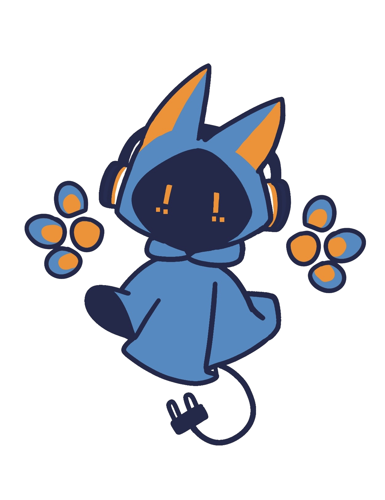
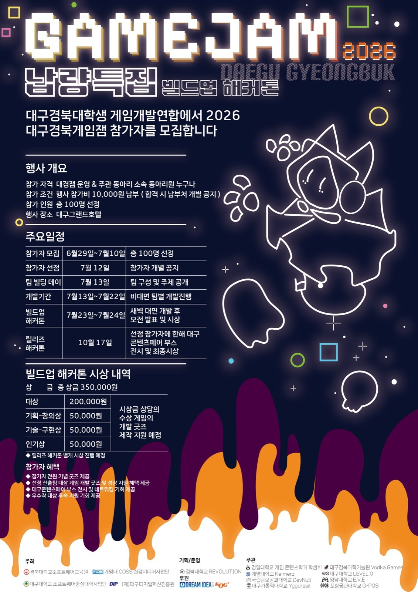
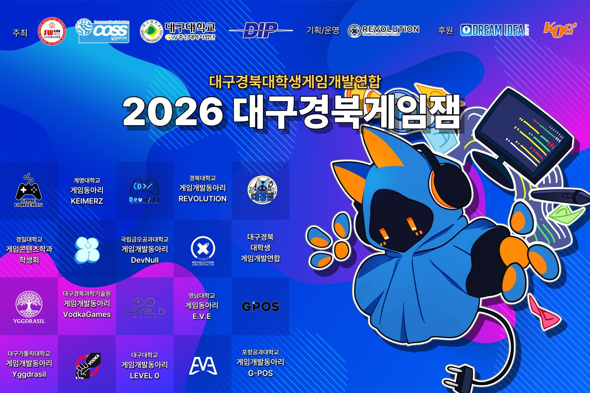

# 2026 대구경북게임잼(대경잼) 활동 기록 · LEVEL 0

대구대학교 게임개발연구동아리 **LEVEL 0**의 2026 대구경북게임잼(대경잼) 운영·참가 기록입니다.
소스코드 저장소가 아니라 활동 내용을 정리한 기록용 저장소입니다.

  

## 한눈에 보기

1. 대구·경북 9개 대학 게임개발 동아리 연합 게임잼
   - 최종 참가 93명, 19개 팀
2. LEVEL 0, 행사 홍보·브랜딩·굿즈 주관 (경일대 게임콘텐츠학과와 협업)
   - 공식 마스코트 SO CAT(쏘캣), 포스터, 티셔츠, 장패드, 아크릴 키링, 등신대 디자인
3. 대구대 학생이 속한 4개 팀, 결선 수상
   - 최우수상 1, 우수상 1, 장려상 2 (엔씨소프트 대표이사상, 결선 8개 팀 전원 시상)

## 행사 개요

| 구분 | 내용 |
| --- | --- |
| 예선 (빌드업 해커톤) | 2026.7.23~24 무박 2일, 계명대 동산도서관 X-Space(개회식)·대구 그랜드호텔, 19개 팀 93명 |
| 결선 (릴리즈 해커톤) | 2026.10.17 대구 EXCO, 예선 통과 8개 팀 발표·심사·시상 |
| 전시 | 대구콘텐츠페어(2026.10.16~17, EXCO) 부스 운영 |
| 주최 | 경북대학교 소프트웨어교육원, 계명대 COSS 실감미디어사업단, 대구대학교 소프트웨어중심대학사업단, 대구디지털혁신진흥원(DIP) |
| 기획/운영 | 경북대학교 REVOLUTION |
| 주관 | 경일대학교 게임콘텐츠학과 학생회, 계명대학교 Keimerz, 국립금오공과대학교 DevNull, 대구가톨릭대학교 Yggdrasil, 대구경북과학기술원 Vodka Games, **대구대학교 LEVEL 0**, 영남대학교 E.V.E, 포항공과대학교 G-POS |
| 후원 | 드림아이디어소프트, KOG / 결선 시상금 일부: 엔씨소프트 |
| 결선 심사 | 엔씨소프트, 넥슨코리아, 펄어비스, 한국인터넷기업협회 |

주최·기획/운영·주관 표기는 공식 포스터를 따랐습니다.

## LEVEL 0의 역할

1. 홍보·브랜딩·굿즈 (2026.3 연합 운영 회의에서 담당 결정)
   - 공식 마스코트 **SO CAT(쏘캣)**
     - 이름: Socket 말장난, Stack Overflow, Scriptable Object Coding Art Team
     - 컬러: 연보라, 주황
   - 포스터, 참가자·스태프 티셔츠, 장패드, 아크릴 키링, 등신대
   - 경일대 게임콘텐츠학과와 협업 (대경잼 로고, 스티커, 포토존)
2. 운영
   - LEVEL 0 운영진이 연합 운영진·TF로 행사 기획과 현장 운영에 참여
3. 참가
   - 예선: 대구대 학생 17명(10개 팀) 참가, 9개 대학 중 두 번째로 많은 인원
   - 본선: 4개 팀 7명 진출

## 결선 결과 (대구대 학생이 속한 팀)

| 수상 | 팀 | 게임 |
| --- | --- | --- |
| 최우수상 | SUNSET PARK 인사팀 | SUNSET PARK |
| 우수상 | 냥빙고 | 100일 냥빙고 |
| 장려상 | 오버클럭 | 백야 |
| 장려상 | 카페인중독자들 | 예외처리규정 |

결선 진출팀은 대구콘텐츠페어에서 이틀간 부스를 운영하며 일반 관람객에게 게임을 시연했습니다.

## 사진

| 공식 포스터 | 포토존 |
| --- | --- |
|  |  |

## 근거 자료

- 대구디지털혁신진흥원(DIP) 「대구경북대학생게임개발연합 [2026 대구경북게임잼] 결선 결과 안내」 공문 (2026.10.24)
  - 개인정보가 포함된 문서라 이 저장소에는 올리지 않았습니다.
- 계명대학교 실감미디어 혁신융합대학사업단 「2026 대구·경북 대학 게임개발 동아리 연합게임잼 빌드업 해커톤 운영 계획(안)」
- 「2026 대경잼 행사 기획안」 (2026.06.25)
